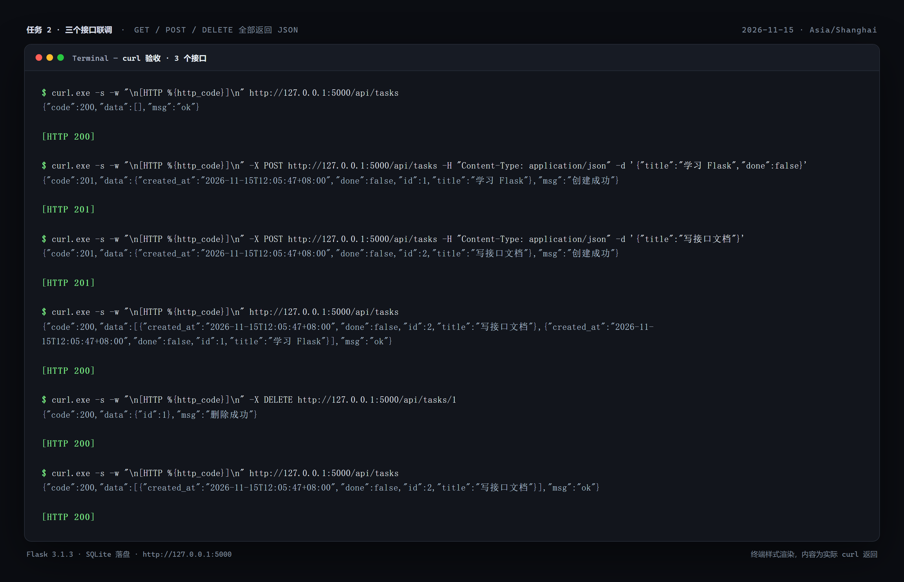

# web-phase4-api-lihaoze · Task API

任务 2：用 **Flask + SQLite** 写 3 个接口，并把数据落盘。

- **技术栈**：Python 3.10+ / Flask 3.1.3 / SQLite（Python 标准库 `sqlite3`）
- **接口数量**：3 个必做（GET / POST / DELETE）+ 1 个加分项（PUT）
- **统一返回**：`{ "code", "data", "msg" }`，错误也返回 JSON
- **数据文件**：`data/tasks.db`，关掉服务再启动数据仍在
- **仓库**：<https://github.com/lihaoze-star/web-phase4-api-lihaoze>
- **接口文档**：[docs/api.md](docs/api.md)

---

## 快速启动

需要 Python 3.10 或更高版本，不需要 Node、不需要数据库服务。

```bash
cd web-phase4-api-lihaoze

# 1. 创建虚拟环境
python -m venv .venv

# Windows PowerShell
.venv\Scripts\Activate.ps1
# macOS / Linux
# source .venv/bin/activate

# 2. 安装依赖
pip install -r requirements.txt

# 3. 启动
python app.py
```

看到下面的输出就说明启动成功：

```text
 * Running on http://127.0.0.1:5000
```

打开 <http://127.0.0.1:5000/api/tasks>，第一次会得到：

```json
{"code":200,"data":[],"msg":"ok"}
```

> 端口被占用时可以用 `PORT=5001 python app.py`（Windows PowerShell 用 `$env:PORT=5001; python app.py`）。
> 首次启动会自动创建 `data/tasks.db` 和 `tasks` 表，不需要手动建库。
> Windows PowerShell 里建议写 `curl.exe`，避免 `curl` 被解析成 `Invoke-WebRequest`；macOS / Linux 用 `curl` 即可。

---

## 接口一览

| 方法 | 路径 | 说明 | 成功状态码 |
| --- | --- | --- | --- |
| `GET` | `/api/tasks` | 获取任务列表 | 200 |
| `POST` | `/api/tasks` | 新增任务 | 201 |
| `PUT` | `/api/tasks/{id}` | 修改任务（加分项） | 200 |
| `DELETE` | `/api/tasks/{id}` | 删除任务 | 200 |

每个接口的参数、返回示例和错误说明见 **[docs/api.md](docs/api.md)**。

统一返回结构：

```json
{
  "code": 200,
  "data": {},
  "msg": "ok"
}
```

- `code` 与 HTTP 状态码一致。
- `data` 成功时是业务数据，失败时是 `null`。
- `msg` 失败时直接说明原因，前端可以展示。

---

## 验收截图

### 1. 三个接口依次调通（GET / POST / DELETE）



### 2. 故意少传字段，返回 400 而不是 500


覆盖的情况：缺少 `title`、`title` 类型错误、`title` 只有空格。三次都是 400，最后一条 `GET` 仍是 200，说明服务没有崩。

### 3. 数据落盘：停止服务、重新启动，数据还在


截图里的两次请求来自两个真实的 Python 进程：第一次进程创建任务后被终止，第二次进程启动后仍能读到同一条数据。

原始 curl 输出保存在：

- [docs/transcripts/api-success.txt](docs/transcripts/api-success.txt)
- [docs/transcripts/api-validation-400.txt](docs/transcripts/api-validation-400.txt)
- [docs/transcripts/api-persistence.txt](docs/transcripts/api-persistence.txt)

> 截图是用真实的 curl 输出渲染的终端样式图（原始文本在上面），不是手写结果。

---

## 参数校验与错误处理

校验在写库之前完成，任何不合法的请求都不会产生半条数据：

- 请求体不是 JSON → 400 `请求体必须是合法的 JSON 对象`
- `Content-Type` 不是 `application/json` → 400
- 缺少 `title` → 400 `缺少字段: title`
- `title` 不是字符串 / 为空 / 超过 80 字 → 400
- `done` 不是布尔值 → 400 `done 必须是布尔值 true/false`
- 删除或修改不存在的任务 → 404 `任务 999 不存在`
- 路由不存在 → 404 `接口不存在`
- 方法不允许 → 405 `请求方法不允许`
- 未捕获异常 → 500 `服务器内部错误`，不返回 HTML 堆栈

全局错误处理在 `app.py` 的 `errorhandler` 中统一收口，因此浏览器直接访问不存在的路径也不会看到 Flask 默认的 HTML 报错页。

---

## 数据落盘

- 默认数据库：`data/tasks.db`（SQLite 单文件）。
- 建表在 `app.py` 的 `init_db()` 中，使用 `CREATE TABLE IF NOT EXISTS`，重复启动不会丢数据。
- 每次请求使用独立连接，写操作在 `with connection:` 事务中提交。

手动验证持久化（PowerShell）：

```powershell
# 1. 创建一条
'{"title":"重启后还在"}' | curl.exe -s -X POST http://127.0.0.1:5000/api/tasks -H "Content-Type: application/json" --data-binary "@-"

# 2. Ctrl+C 停止服务，再执行 python app.py

# 3. 再查一次，刚才的数据还在
curl.exe -s http://127.0.0.1:5000/api/tasks
```

> Git Bash / macOS / Linux 可以把 `'{"title":"重启后还在"}' | curl.exe ... --data-binary "@-"` 换成常见的 `curl -s -X POST ... -d '{"title":"重启后还在"}'`。

想清空数据时，停止服务后删除 `data/tasks.db`，再启动即可。

---

## CORS

任务 3 的前端和 API 不在同一个源，所以 Flask 在 `after_request` 里统一加响应头：

```text
Access-Control-Allow-Origin: <请求的 Origin>
Access-Control-Allow-Methods: GET, POST, PUT, DELETE, OPTIONS
Access-Control-Allow-Headers: Content-Type
Access-Control-Max-Age: 86400
Vary: Origin
```

`OPTIONS` 预检由 Flask 自动处理，`after_request` 同样会给预检响应加头。错误响应也会带上这些头，避免 GET 修好了、POST 又失败。

验证：

```bash
curl -i -H "Origin: http://127.0.0.1:8000" http://127.0.0.1:5000/api/tasks
```

前端任务页与完整的 CORS 报错记录：
<https://github.com/lihaoze-star/web-phase4-lihaoze/blob/main/docs/cors-record.md>

---

## 流式对话 `/api/chat`

任务 4 的聊天页通过这个接口调 DeepSeek。Key 只从服务端 `.env` 读取，前端只拿到 SSE delta。

1. 复制模板并填写 Key：

   ```powershell
   Copy-Item .env.example .env
   notepad .env
   ```

   ```env
   LLM_PROVIDER=deepseek
   LLM_MODEL=deepseek-chat
   LLM_API_KEY=sk-...
   MAX_CONTEXT_CHARS=6000
   ```

   `.env` 已在 `.gitignore` 中，不会提交。

2. 请求：

   ```http
   POST /api/chat
   Content-Type: application/json

   {"messages":[{"role":"user","content":"介绍一下 fetch"}]}
   ```

3. 响应是 `text/event-stream`：

   ```text
   data: {"delta":"fetch"}

   data: {"delta":" 是"}

   data: {"done":true}
   ```

   错误也走 SSE：`data: {"error":"API Key 无效或已过期..."}`。

> 线上环境用的 localhost.run 免费隧道偶尔不转发 `OPTIONS` 预检，所以前端聊天用 `Content-Type: text/plain` 发送 JSON（简单请求，不触发预检）；`read_chat_messages()` 同时接受 `application/json` 和 `text/plain`，校验逻辑不变。

- **系统提示词**：`app.py` 的 `SYSTEM_PROMPT`，限定课程学习助手，不编造、不泄露 Key、不代写整份作业。
- **上下文截断**：`trim_context()` 从最早的消息开始丢弃，总字符数不超过 `MAX_CONTEXT_CHARS`。
- **停止生成**：前端 abort 后，生成器在 `GeneratorExit` / 写失败时关闭上游 `requests` 响应。
- **错误映射**：401 Key 错、402 余额不足、403 无权限、429 限流、超时、连接失败、5xx 都有中文提示。

支持 DeepSeek / 智谱 GLM / 阿里百炼 / 火山方舟的 OpenAI 兼容接口；豆包需要把接入点 ID 填到 `LLM_MODEL`。

---

## 工具调用

对话接口还挂了两个工具，直接操作任务 API 的同一个 SQLite 库：

| 工具 | 作用 | 参数 |
| --- | --- | --- |
| `add_item` | 新增任务，执行 `INSERT INTO tasks` | `title`（必填，1-80 字）、`done`（可选） |
| `query_items` | 按条件查询任务 | `status`（`all`/`todo`/`done`）、`keyword`、`limit` |

流程：模型返回 `tool_calls` → Flask 执行 SQLite → 结果以 `role=tool` 回填 → 模型用自然语言总结。工具失败会作为结果回给模型，不会中断整轮对话。

前端通过 SSE 事件显示工具日志：

```text
data: {"tool_call":{"name":"add_item","arguments":{"title":"明天交实验报告"},"result":{"ok":true,"item":{...}}}}
```

完整链路、失败案例和前后数据截图见：
<https://github.com/lihaoze-star/web-phase4-lihaoze/blob/main/docs/task5.md>

---

## 测试

```bash
python -m unittest discover -s tests -v
```

当前结果：**32 个测试全部通过**，覆盖：

- 空列表、创建、查询、修改、删除
- 缺字段、类型错误、空标题、超长标题、坏 JSON、错误 Content-Type
- 404 / 405 / 500 都返回 JSON
- 正常响应、错误响应、OPTIONS 预检都带 CORS 头
- SQLite 中确实写入了数据
- 聊天参数校验、mock 流、上下文截断、401 / 429 / 超时中文提示
- `add_item` 写库、`query_items` 过滤、工具参数校验

测试使用独立的 `.tmp/tasks-test.db`，不会污染演示数据。

---

## 目录结构

```text
web-phase4-api-lihaoze/
├── app.py                       # Flask：任务 API + 流式聊天 + CORS + SQLite
├── requirements.txt             # Flask / gunicorn / requests / python-dotenv
├── Procfile                     # Render / Railway 启动命令
├── render.yaml                  # Render 一键创建 Web Service
├── .env.example                 # 环境变量模板（真实 .env 已 gitignore）
├── README.md
├── data/
│   └── tasks.db                 # 运行时自动生成（已 gitignore）
├── docs/
│   ├── api.md                   # 接口文档（方法 / 路径 / 参数 / 返回示例）
│   ├── transcripts/             # 原始 curl 输出
│   └── screenshots/             # 验收截图
├── scripts/
│   ├── make_transcripts.py      # 生成三个接口 + 400 的真实 curl 记录
│   ├── persistence_check.py     # 自动完成“启动 → 写入 → 重启 → 再读”
│   ├── render_terminal.py       # 把记录渲染成终端样式 HTML
│   └── capture_terminal.mjs     # 用 Edge 截图
├── tests/
│   └── test_api.py              # 32 个 unittest
└── .gitignore
```

---

## curl 验收命令

> **Windows PowerShell 注意**：`-d '{"title":"..."}'` 里的双引号会被 PowerShell 吞掉，实际发出去会变成 `{title:...}`，服务会返回 400。  
> PowerShell 下请把 JSON 通过管道交给 `curl.exe --data-binary "@-"`，也就是下面第一段写法。

### Windows PowerShell

```powershell
# 1. 列表
curl.exe -s http://127.0.0.1:5000/api/tasks

# 2. 新增
'{"title":"学习 Flask","done":false}' | curl.exe -s -X POST http://127.0.0.1:5000/api/tasks -H "Content-Type: application/json" --data-binary "@-"

# 3. 删除（把 1 换成上一步返回的 id）
curl.exe -s -X DELETE http://127.0.0.1:5000/api/tasks/1

# 4. 故意少传 title，应该是 400，不是 500
'{"done":true}' | curl.exe -s -X POST http://127.0.0.1:5000/api/tasks -H "Content-Type: application/json" --data-binary "@-"
```

### Git Bash / macOS / Linux

```bash
# 1. 列表
curl -s http://127.0.0.1:5000/api/tasks

# 2. 新增
curl -s -X POST http://127.0.0.1:5000/api/tasks \
  -H "Content-Type: application/json" \
  -d '{"title":"学习 Flask","done":false}'

# 3. 删除（把 1 换成上一步返回的 id）
curl -s -X DELETE http://127.0.0.1:5000/api/tasks/1

# 4. 故意少传 title，应该是 400，不是 500
curl -s -X POST http://127.0.0.1:5000/api/tasks \
  -H "Content-Type: application/json" \
  -d '{"done":true}'
```

成功响应示例：

```json
{"code":201,"data":{"id":1,"title":"学习 Flask","done":false,"created_at":"2026-11-15T12:05:47+08:00"},"msg":"创建成功"}
```

失败响应示例：

```json
{"code":400,"data":null,"msg":"缺少字段: title"}
```

---

## 部署到 Render

仓库已经带了 `render.yaml` 和 `Procfile`，不需要手写启动命令：

1. Render → **New → Web Service** → 连接 `web-phase4-api-lihaoze` 仓库。
2. Render 会识别 `render.yaml`，使用 `pip install -r requirements.txt` 和 `gunicorn app:app`。
3. 部署完成后，把 Render 给出的 HTTPS 地址填到前端仓库的 `js/config.js`：

   ```js
   baseUrl: "https://your-service.onrender.com"
   ```

4. 重新推送前端，任务页即可在线上读写这个 API。

> 免费实例长时间无请求会休眠，第一次打开可能慢几秒；这是平台行为，不是接口错误。

---

## 说明

- 这是任务 2 的提交版本，重点是「接口能调通、错误是 JSON、数据真的落盘」。
- 没有引入 ORM、蓝图、鉴权等额外内容，保持一周作业的可读范围。
- 所有接口的 `code` 与 HTTP 状态码保持一致，便于用 `curl -i` 或浏览器 Network 面板核对。
- 任务 3 的前端页面与三种状态截图在
  <https://github.com/lihaoze-star/web-phase4-lihaoze> 的 `tasks.html` 与 `docs/task3.md`。
